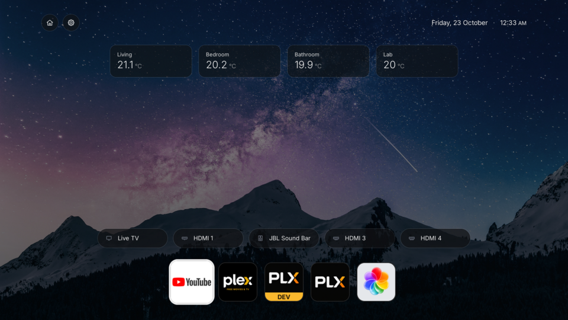
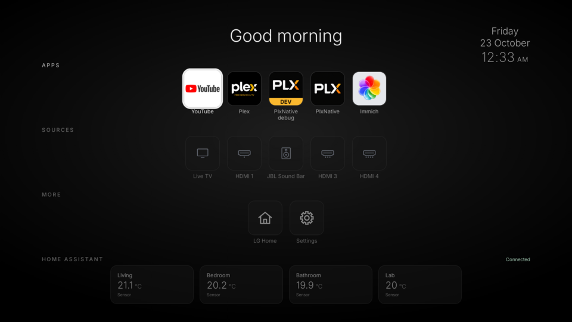

# webOS Launcher

A minimalist home screen for LG webOS TVs with two layouts: a labelled normal view
and a wallpaper view with a compact top bar, optional Home Assistant sensor cards,
source badges and an app dock. Built for **webOS 6 (Chrome 79)**, where sideloaded
web apps are more restricted than on newer firmware.

- **Apps**: your choice of apps, in your order
- **Sources**: Live TV and the HDMI inputs, with the names set in the TV's input settings
- **More**: LG's own home screen and Settings, with house and cog icons
- Black background with a soft grey gradient, or an optional wallpaper from the TV filesystem
- Optional fourth Home Assistant section with MQTT sensor readings and action buttons
- Remote-first navigation and a compact four-section layout when Home Assistant is enabled
- Follows the TV's 12/24-hour clock setting
- Core launcher works without root; filesystem wallpaper and plain TCP MQTT use the Homebrew Channel on rooted TVs

> **Fork features:** wallpaper layouts and the MQTT dashboard are additions in this
> fork. Build this checkout to get them; the upstream Homebrew Channel package may
> not include these changes.

## Screenshots

Captured on a real TV with the same apps, sources and four MQTT temperature cards.
The wallpaper and selected cards shown here are user-configured, not bundled defaults.

### Wallpaper mode

Compact Home/Settings buttons and clock, quiet sensor cards, source badges and an
icon-only app dock leave the wallpaper visible.



### Normal mode

The labelled layout keeps the greeting, app names, row titles and MQTT diagnostics
visible for setup and debugging.



## Using it

| Where | Key | Does |
|---|---|---|
| Home | ↑ ↓ | Move between rows |
| Home | ← → | Move along a row |
| Home | OK | Open an app/input, activate a utility, or send a configured MQTT button message |
| Settings | OK | Add or remove an app/source |
| Settings | Hold OK (or **Re-order** button) | Enter/leave re-order mode |
| Re-order mode | OK, arrows, OK | Pick up a tile, move it, put it down |
| Re-order mode | Back | Cancel the move / leave re-order mode |
| Settings | Back | Return home |
| MQTT configuration | ↑ ↓, OK | Move between fields and edit or activate the selected field |
| MQTT text field | Back | Finish editing; Back again cancels the card/configuration |

In wallpaper mode, vertical navigation follows the visible order: **Home/Settings →
Home Assistant (when enabled) → Sources → Apps**. Each section remembers its horizontal
selection. Sensor cards display values; OK only sends an action for button cards.

The Magic Remote pointer is hidden when the launcher opens; shake the remote to bring it
back. Clicking works everywhere.

The launcher doesn't take over the HOME button. On a rooted TV you can map a button to it
with [LG Input Hook](https://github.com/Simon34545/lginputhook) (app ID
`works.partridge.webos-launcher`).

## Install

**For this fork:** build and install the `.ipk` using the instructions below.

**Upstream package from the Homebrew Channel** (rooted TVs): search for *Launcher*.
This is an alternative to building the fork, and may have a different feature set.

**From a release**: download the `.ipk` from
[Releases](../../releases) and install it with the Homebrew Channel, the
[webOS CLI](https://webostv.developer.lge.com/develop/tools/cli-installation)
(`ares-install`), or [webOS Dev Manager](https://github.com/webosbrew/dev-manager-desktop).
It also works in LG's Developer Mode, without root.

## Build

Needs Node 20+ on your computer (CI uses Node 22). The optional TV relay targets the
TV's existing Node 8 runtime; you do not need to upgrade Node on the TV.

```sh
npm install
npm test           # settings, navigation, payloads, connection lifecycle and relay checks
npm run build      # type-check, build Chrome 79 UI + Node 8 TCP relay into dist/
npm run package    # dist/ → build/works.partridge.webos-launcher_<version>_all.ipk
```

To install on a rooted TV over SSH, copy `tv.env.example` to `tv.env` (git-ignored) and
set `TV_HOST` to an ssh alias or `root@<tv-ip>`, then:

```sh
npm run install:tv   # copy the ipk over SSH, install it, launch it
npm run deploy       # build + package + install:tv
```

`npm run dev` serves the UI in a desktop browser with sample inputs and the whole
catalogue, for layout work without a TV.

## Which apps appear

webOS 6 doesn't let a sideloaded web app list the installed apps or read their icons.
So the launcher ships a catalogue ([src/config/catalog.ts](src/config/catalog.ts)) with
icon copies in [public/icons/apps/](public/icons/apps/), and shows only the entries the TV
reports as installed (`applicationManager/getAppLoadStatus`, which is allowed). Apps
without a bundled icon get a plain monogram tile.

To add your own apps or change the default row **without editing tracked files**, copy
[src/config/catalog.local.example.ts](src/config/catalog.local.example.ts) to
`src/config/catalog.local.ts` (git-ignored) and rebuild.

### Option: live app list via the Homebrew Channel (off by default)

*Settings → Options → Live app list via Homebrew Channel.*

On a rooted TV with the [Homebrew Channel](https://github.com/webosbrew/webos-homebrew-channel),
turning this on reads the full list of installed apps and their real icons, instead of
the catalogue. It works by asking the Homebrew Channel's service to run
`luna-send ... listLaunchPoints` and to base64-encode each icon file. **Those commands run
as root.** The launcher only sends fixed commands; icon paths are validated and
shell-quoted before use, and app IDs never reach the shell. If the Homebrew Channel isn't
there, the launcher says so and uses the catalogue. Icons are cached in the app's local
storage.

## Wallpaper

In **Settings → Options**, turn **Wallpaper** on. The Homebrew Channel reads the first
non-empty file up to 4 MiB from this list (in order):

- `/media/internal/webos-launcher/wallpaper.jpg`
- `/media/internal/webos-launcher/wallpaper.jpeg`
- `/media/internal/webos-launcher/wallpaper.png`
- `/media/internal/webos-launcher/wallpaper.webp`

For example, from your computer:

```sh
# Replace TV_IP with your TV's address.
ssh root@TV_IP 'mkdir -p /media/internal/webos-launcher'
scp -O ~/Pictures/wallpaper.jpg root@TV_IP:/media/internal/webos-launcher/wallpaper.jpg
```

Use a landscape image, ideally around 1920×1080, to limit decoding memory on the TV.
Wallpaper mode uses its own layout: small round LG Home and Settings buttons at the
upper left, a single-line date and clock at the upper right, centered Home Assistant
cards below, source badges above a bottom row of app thumbnails. The greeting, row
titles, app names and sensor diagnostics are hidden in this mode. Remote arrows follow
that visual order and each section remembers its selection. Turning Wallpaper off
restores the normal layout with its labels and diagnostic information.

The image fills the screen with a dark overlay for legibility. It is read when the
option is enabled and whenever the launcher returns to the foreground. Replace the
file and reopen the launcher to refresh it. Keep one wallpaper file in the folder;
the first supported file wins. If reading or decoding fails, the gradient stays visible
and the launcher shows an error. Images are not cached in localStorage. The folder
lives outside the installed app and survives app updates. Reading uses bounded,
sequential chunks to stay within the Homebrew service's output limit. The normal app
list, wallpaper reads and MQTT relay startup share a command queue.

## Home Assistant information and buttons

Turn on **Settings → Options → Home Assistant** to reveal **Home Assistant
configuration** and a fourth section on the home screen. Turning it off hides both,
closes MQTT, and keeps the saved cards for next time. There are no incoming TV commands,
Home Assistant discovery entities, or changes to your existing Home Assistant TV integration.

In configuration, enter your broker URL and optional username/password, then add up to
12 cards. **Keep card** returns to the connection screen; **Save configuration** applies
all edits. Back cancels the current card or configuration. Cards appear in list order;
edit a card to remove it or move it earlier. Use ↑/↓ to move between fields, OK to edit,
and Back to finish editing. Pointer clicks and the TV keyboard are supported.

Broker URLs:

- `mqtt://BROKER_IP:1883`: ordinary MQTT, requires a rooted TV with the Homebrew
  Channel. The launcher starts a bundled Node 8 compatible relay bound to
  `127.0.0.1:18783`. It forwards MQTT to the chosen broker, accepts only local-file
  app origins, and exits after 90 seconds without clients. No boot hooks or registered
  services are installed. Broker addresses and credentials never enter the root shell.
- `ws://broker:9001/mqtt` or `wss://broker/mqtt`: direct MQTT over WebSockets; your
  broker must have a WebSocket listener enabled. These also work in desktop previews.
  Certificate trust uses the TV/browser's normal trust store.

The relay is built into the app package by `npm run build`. It uses the TV's existing
`/usr/bin/node` and the Homebrew Channel execution service. TLS TCP (`mqtts://`) is not
supported; use a trusted `wss://` endpoint when encrypted transport is needed. Credentials
are stored in the launcher's localStorage on this TV. A dedicated broker account can
restrict reads to your sensor topics and writes to your button topics.

### Sensor cards

Each sensor has a label, exact **state topic**, optional **JSON field**, and optional
unit. For a Zigbee2MQTT climate sensor, for example:

| Field | Value |
|---|---|
| Label | Room temperature |
| State topic | `zigbee2mqtt/example_climate` |
| JSON field | `temperature` |
| Unit | `°C` |

A payload such as `{"temperature":21.2,"humidity":61}` displays **21.2 °C**. Add another
card on the same topic with field `humidity` and unit `%` to display humidity. For a
plain-text payload, leave JSON field empty. Nested fields such as `room.temperature`
work; templates and expressions are not evaluated. Wildcard subscriptions are not used.
Missing fields or malformed JSON display a dash. Normal mode shows connection status
and hints such as “Sensor”, “Waiting for a reading” or “Offline · last reading”.
Wallpaper mode displays only card labels and values, without those diagnostics.
Reconnecting clears the previous readings, resubscribes and waits for retained or new
messages. The launcher does not persist sensor values between sessions.

Card labels are independent of MQTT topic names: a card labelled **Room temperature**
can read `zigbee2mqtt/example_climate_v2`, for example. Renaming a card does not rename
the device or change its topic. Cards and broker settings are saved per TV in localStorage; there
are no room names or sensor topics preconfigured in a fresh installation.

Home Assistant does not automatically publish all entity states to MQTT. Existing
Zigbee2MQTT topics can be used directly. For other entities, publish retained readings
with a Home Assistant automation using
[`mqtt.publish`](https://www.home-assistant.io/integrations/mqtt/#action-mqttpublish),
or use [`mqtt_statestream`](https://www.home-assistant.io/integrations/mqtt_statestream/)
to export selected sensors. Retained readings let the launcher show a value immediately
after opening; otherwise it waits for the sensor's next report.

### Showing the last reading immediately

The launcher already accepts retained MQTT messages. In Zigbee2MQTT, enable **Retain**
for each displayed sensor, or set `retain: true` in that device's configuration. See
[Zigbee2MQTT device options](https://www.zigbee2mqtt.io/guide/configuration/devices-groups.html).
The broker can replay the latest retained payload whenever the launcher reconnects.

Enabling retention does not turn an earlier, non-retained message into a retained one:
the sensor topic must be published again with retain enabled. Some cards can therefore
show values while others still show a dash until their next report. For a missing
reading, check the exact topic, the JSON field (usually `temperature`), and whether
that topic actually has a retained payload containing the field. A healthy MQTT
connection alone does not guarantee a reading for every card.

### Button cards

A button has a label, exact **command topic**, and **payload** (text or JSON). Pressing
it sends that message once with QoS 0 and retain off. Actions are never queued while
offline. “Sent” confirms sending the message, not that Home Assistant completed an action.
For example, configure a button with topic `launcher/actions/movie` and payload `PRESS`,
then create this Home Assistant automation (replace the scene with your own):

```yaml
alias: TV launcher movie scene
triggers:
  - trigger: mqtt
    topic: launcher/actions/movie
    payload: PRESS
actions:
  - action: scene.turn_on
    target:
      entity_id: scene.movie
```

The connection runs while webOS keeps the launcher active. It is a glanceable dashboard,
not an always-running Home Assistant service. Returning to the launcher reconnects as
needed. It subscribes only to configured sensor topics and publishes only when a
configured button is pressed.

## Compatibility and testing

The upstream compatibility baseline is an LG OLED C1 (2021) running **webOS 6.5**,
rooted, with Homebrew Channel 0.7.3. This fork's wallpaper loading, both home layouts,
remote navigation, live MQTT readings and button publishing were also checked on the
development TV running **Chrome 79** and **Node 8.12.0**. Broad model and firmware
compatibility has not been established:

- Newer webOS (22 and later) should run it, since the build targets an older engine, but
  the Luna calls it relies on haven't been confirmed there.
- Older webOS (5 and earlier) is unknown; the External Input Manager call
  (`com.webos.service.eim/getAllInputStatus`) may differ.
- Only the UK app IDs in the catalogue were checked on a real TV. The others come from
  public sources and are simply skipped if wrong.

Run `npm test` for automated checks covering configuration migration, card validation,
MQTT payloads and reconnects, retained readings, offline button behavior, the TCP relay,
wallpaper transfers, both home layouts and remote navigation. `npm run build` checks
TypeScript and builds the Chrome 79 UI plus the Node 8 compatible relay.

### Notes for developers

- **Chrome 79.** `<script type="module">` won't load from `file://` on webOS 6 (no MIME
  type), and `?.`/`??` are syntax errors. [vite.config.ts](vite.config.ts) builds one IIFE
  for `chrome79` and rewrites the script tag; CI fails the build if ES2020 syntax slips
  in. The CSS avoids flex `gap`, `inset` and `aspect-ratio`.
- **Luna calls used** (all in the "public" LS2 group a web app gets):
  `applicationManager/launch`, `applicationManager/getAppLoadStatus`,
  `eim/getAllInputStatus`, `systemservice/getPreferences` (`timeFormat`). Denied to web
  apps on webOS 6: `listLaunchPoints`, `listApps`, `getAppInfo`, `getForegroundAppInfo`.
- **Homebrew commands.** The optional live app list, filesystem wallpaper and TCP relay
  startup use the Homebrew Channel's root execution service. A shared queue avoids
  overlapping commands, and wallpaper transfers are chunked to avoid stdout limits.
- **MQTT compatibility.** A small `Array.at` shim supports the MQTT client's subscription
  handling on Chrome 79. Plain MQTT URLs are parsed through an HTTP authority because
  that browser treats the `mqtt:` scheme as an opaque URL.
- **Pointer.** The pointer is drawn by the system, so CSS `cursor: none` does nothing;
  the app calls `webOSSystem.setCursorHidden(true)` when it comes to the foreground.
- **Remote debugging.** A dev-mode or rooted TV exposes the web inspector on port 9998.

## Project layout

```
src/
  config/      constants (IDs, key codes, Luna URIs) and the app catalogue
  theme/       design tokens (colours, type, layout, motion) and the stylesheet
  lib/         Luna/Homebrew bridges, wallpaper, MQTT, storage, app/input providers, clock
  hooks/       remote keys, OK press/hold, clock tick, time format
  components/  tiles, source badges, Home Assistant cards, wallpaper, remote form, icons
  screens/     Home, Settings, MqttSettings
  app.tsx      state, data loading and wiring
bridge/        localhost WebSocket-to-TCP MQTT relay (bundled for Node 8)
tests/         configuration, MQTT, relay, wallpaper and navigation checks
docs/          screenshots captured from the TV for this README
scripts/       package.sh, install.sh, gen-manifest.mjs
public/        appinfo.json, app icon, bundled icons, licence texts
.github/       build on push; release (ipk + Homebrew manifest) on tag
```

## Releasing

Bump `version` in `public/appinfo.json` (and `package.json`), commit, then push a
matching tag:

```sh
git tag v1.0.1 && git push origin v1.0.1
```

The release workflow builds the ipk, generates the Homebrew Channel manifest
(`works.partridge.webos-launcher.manifest.json`, with the ipk's SHA-256) and attaches both
to a GitHub release. The Homebrew repository reads the manifest from the latest release.

## Licence and credits

Code: [MIT](LICENSE). Bundled Preact, MQTT.js, ws and the Inter typeface: see
[THIRD_PARTY_NOTICES.md](THIRD_PARTY_NOTICES.md).

**Third-party icons.** The app and input icons in `public/icons/` belong to their owners
and are not covered by the MIT licence. They're included in good faith, only to show
recognisable tiles for apps already on the user's TV. Rights holders can ask for removal
by opening an issue; see [THIRD_PARTY_NOTICES.md](THIRD_PARTY_NOTICES.md). This project is
not affiliated with LG Electronics or any app publisher.

Written with AI assistance (Claude Code), directed, tested and reviewed by a human on a
real TV.
